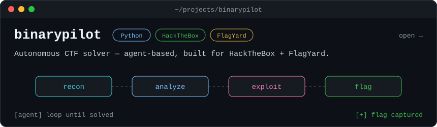

  

  

<h3 align="center"><code>$ ls ~/projects</code></h3>

  

<h3 align="center"><code>$ which --all toolchain</code></h3>

  

  <code>[process 0x1DA still running — building, learning, shipping in public]</code>

